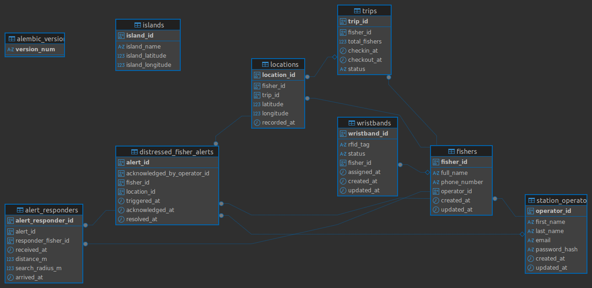

# Entity Relationship Diagram

> Generated from the database schema. Re-export it whenever the SQLAlchemy models or Alembic migrations change.

## How to read it

- Each box is a table. The bold column is the primary key.
- Lines connect a foreign key to the table it points at.
- `alembic_version` and `islands` are standalone tables with no foreign keys.

## Relationships

| From | To | Through | Meaning |
| --- | --- | --- | --- |
| `fishers` | `station_operators` | `fishers.operator_id` | Each fisher is registered by a station operator. |
| `wristbands` | `fishers` | `wristbands.fisher_id` | A wristband (RFID tag) is assigned to a fisher. |
| `trips` | `fishers` | `trips.fisher_id` | A fisher takes trips. |
| `locations` | `trips`, `fishers` | `locations.trip_id`, `locations.fisher_id` | Each location record belongs to a trip and a fisher. |
| `distressed_fisher_alerts` | `fishers` | `fisher_id` | The fisher in distress. |
| `distressed_fisher_alerts` | `locations` | `location_id` | Where the fisher was when the alert was raised. |
| `distressed_fisher_alerts` | `station_operators` | `acknowledged_by_operator_id` | The operator who acknowledged the alert. |
| `alert_responders` | `distressed_fisher_alerts` | `alert_id` | The alert being responded to. |
| `alert_responders` | `fishers` | `responder_fisher_id` | The nearby fisher asked to help. |

`fishers` is linked to `alert_responders` twice in practice: once as the person in distress (through the alert) and once as a responder.