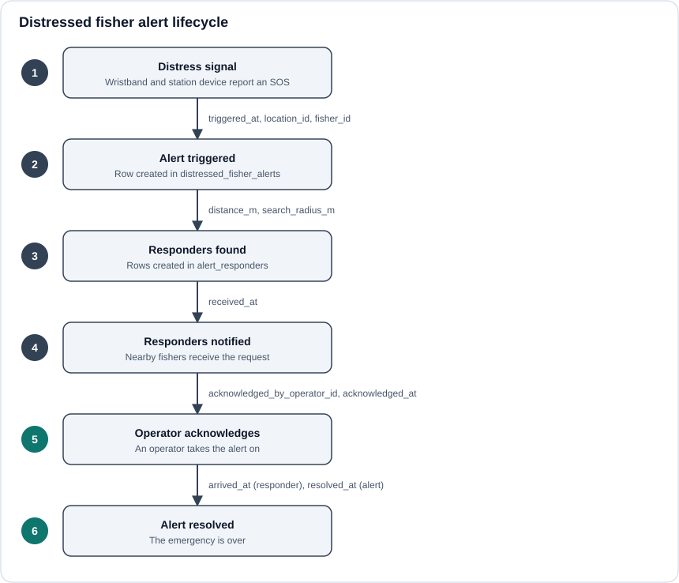

# Key Entities

## Fishers

The people the system protects. Stores `full_name`, `phone_number`, the registering `operator_id`, and `created_at` / `updated_at`. A fisher can be in distress, or be asked to respond to someone else's alert.

## Wristbands

The wearable that carries the RFID tag. Stores `rfid_tag`, `status`, the `fisher_id` it is assigned to, and `assigned_at`. Assigning a wristband to a fisher is what ties a physical signal to a person.

## Station_operators

Staff who run a landing station and use the dashboard. Stores `first_name`, `last_name`, `email` and `password_hash`. Operators register fishers and acknowledge alerts. Passwords are never stored in plain text.

## Trips

A fishing trip. Stores `fisher_id`, `total_fishers`, `checkin_at`, `checkout_at` and `status`. A trip is the context that gives location records meaning.

## Locations

GPS points recorded during a trip. Stores `fisher_id`, `trip_id`, `latitude`, `longitude` and `recorded_at`. The latest location is what an alert points at.

## Islands

Reference data for the fishing areas. Stores `island_name`, `island_latitude` and `island_longitude`.

## Distressed_fisher_alerts

One row per emergency.

| Column | Meaning |
| --- | --- |
| `fisher_id` | Who is in distress. |
| `location_id` | Where they were. |
| `triggered_at` | When the alert was raised. |
| `acknowledged_by_operator_id` | Which operator took it on. |
| `acknowledged_at` | When the operator took it on. |
| `resolved_at` | When the emergency ended. Empty while the alert is open. |

## Alert_responders

One row per fisher asked to help with an alert.

| Column | Meaning |
| --- | --- |
| `alert_id` | The alert. |
| `responder_fisher_id` | The nearby fisher asked to help. |
| `received_at` | When the responder was notified. |
| `distance_m` | How far the responder was from the alert, in metres. |
| `search_radius_m` | The search radius used to find them, in metres. |
| `arrived_at` | When the responder reached the fisher in distress. |

## How an alert moves through the tables

An alert is open until `resolved_at` is set. The dashboard computes things like nearest responders and response status from these timestamps rather than storing them separately.