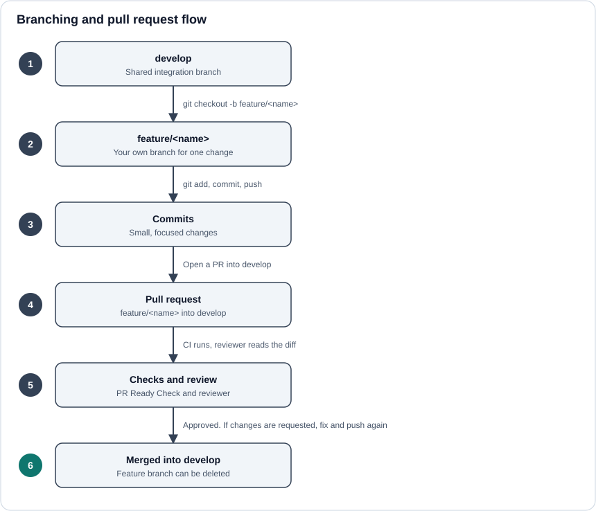

# Branching and Pull Requests



## Branches

- `develop` is the shared integration branch. All finished work lands here.
- Create one branch per feature or fix, named after what it does, for example `feature/responder` or `feature/faq`.
- Never commit directly to `develop`.

## Working on a change

```bash
git checkout develop
git pull
git checkout -b feature/<name>
# make your changes, then
git add .
git commit -m "Describe what changed"
git push -u origin feature/<name>
```

Keep each branch and PR to **one** concern. If you notice unrelated work in your branch, move it to its own branch and PR. For example, `alert_responders` files should not travel inside a PR that is only about the `distressed_fisher_alerts` entity.

## Opening the pull request

1. Open a PR from `feature/<name>` **into `develop`**.
2. Fill in the PR description. The **PR Ready Check** fails if any of these are missing:
   - a screen recording or demo,
   - screenshots,
   - a Figma link for UI work,
   - the self-review box ticked.
3. Request a review.

## Review and merge

The reviewer may request changes. Fix them on the same branch and push again; the PR updates automatically. Once the checks pass and the reviewer approves, merge into `develop`.

## Before you push

Run the formatter and linter so reviewers do not have to ask:

```bash
npx prettier@3.6.2 --write .
npm run lint -- --fix
```

Also check the page on a small screen. Responsive problems are a common review comment.