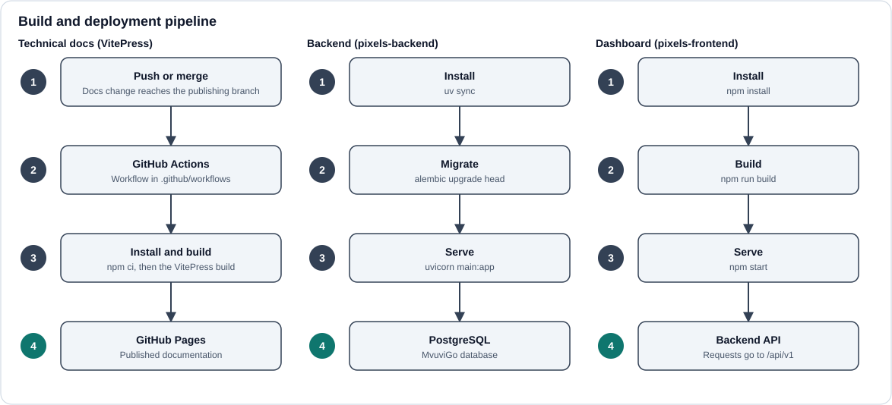

# Deployment



This page describes how MvuviGo is built, deployed, configured, monitored and recovered. Items marked **TO CONFIRM** depend on infrastructure details that are not recorded in the repositories. Replace each one with the real value before relying on this page.

## Overview

| Part | Repository | Technology | Hosting | Deployed by |
| --- | --- | --- | --- | --- |
| Backend API | `pixels-backend` | FastAPI, SQLAlchemy, Alembic | **TO CONFIRM** | **TO CONFIRM** |
| Dashboard | `pixels-frontend` | Next.js (JSX), Tailwind | **TO CONFIRM** | **TO CONFIRM** |
| Database | none | PostgreSQL | **TO CONFIRM** | Alembic migrations |
| Documentation site | `pixels-technical-documentation` | VitePress | GitHub Pages | GitHub Actions |
| Public website | `pixels-informational-website` | **TO CONFIRM** | **TO CONFIRM** | **TO CONFIRM** |

## Deployment targets

| Target | Purpose | Notes |
| --- | --- | --- |
| Development | Local work on a developer machine | Local PostgreSQL, `--reload`, `npm run dev`. |
| Staging | Pre-release checks | **TO CONFIRM** whether a staging environment exists. If not, state "none" here. |
| Production | Live system used by station operators | Deployed only from the release branch (see [Release process](#release-process)). |

## Hosting

### Hosting platform

**TO CONFIRM:** name the platform or provider used for the backend, dashboard and database (for example a cloud provider, a PaaS or a VPS), the account or project that owns it, and who has access.

### Backend hosting

- Runs as a Python process serving `main:app` with uvicorn.
- The API is served under `/api/v1`.
- Host: **TO CONFIRM**. Public URL: **TO CONFIRM**.
- The host must provide the environment variables listed below and outbound access to the database.

### Frontend hosting

- Runs as a Next.js production server (`npm start`) after `npm run build`.
- Host: **TO CONFIRM**. Public URL: **TO CONFIRM**.
- The documentation site is a static VitePress build hosted on GitHub Pages.

### Database hosting

- PostgreSQL. Host or managed service: **TO CONFIRM**. Version: **TO CONFIRM**.
- The production database must not be reachable from the public internet. Only the backend should be able to connect.
- Backups: see [Rollback and recovery](#rollback-and-recovery).

## External services

| Service | Purpose | Used by | Configuration |
| --- | --- | --- | --- |
| GitHub | Source hosting, pull request checks, GitHub Actions, GitHub Pages | All repositories | Workflows in `.github/workflows` |
| Map tile provider | Base map for the Live Incidents map | Dashboard | **TO CONFIRM** provider and any API key |
| Figma | Design reference only | Developers | Not used at runtime |
| Other (email, SMS, push, storage) | **TO CONFIRM** | **TO CONFIRM** | If none exist, write "none". |

## Environment variables

Real values are never committed. Keep a `.env.example` in each repository that lists names with dummy values.

### Backend

| Variable | Purpose | Production value |
| --- | --- | --- |
| Database connection setting | Connection string for PostgreSQL. **TO CONFIRM** the exact variable name. | Production database, stored in the host's secret store |
| Authentication or signing secret | Signs tokens, if used. **TO CONFIRM** the name. | Long random value, different from development |
| Allowed CORS origins | Origins permitted to call the API. **TO CONFIRM** whether this is configurable. | The dashboard's production URL only |
| Debug flag | Enables verbose errors. **TO CONFIRM** the name. | Off |

### Dashboard

| Variable | Purpose | Production value |
| --- | --- | --- |
| API base URL | Base URL that `lib/api.js` calls. **TO CONFIRM** the exact variable name. | The backend's production URL ending in `/api/v1` |

If the variable is exposed to the browser (a `NEXT_PUBLIC_` variable in Next.js), its value is fixed at build time. Rebuild the dashboard whenever it changes.

### Where secrets live

**TO CONFIRM:** name the place production secrets are stored (host secret manager, GitHub Actions secrets, and so on) and who can change them. Rotate any secret that has been exposed in a commit, log or chat.

## Build process

| Part | Commands | Output |
| --- | --- | --- |
| Backend | `uv sync` | Installed environment. There is no compile step. |
| Dashboard | `npm install` then `npm run build` | Production build in `.next` |
| Documentation | `npm install` then `npm run docs:build` | Static site in the VitePress output folder |

## Deployment process

Deploy in this order so each part finds what it depends on.

1. **Back up the production database** (see [Rollback and recovery](#rollback-and-recovery)).
2. **Backend**
   1. Pull the release version of `pixels-backend`.
   2. Run `uv sync`.
   3. Run `alembic upgrade head` against the production database. Run it on every deploy so the schema matches the models.
   4. Restart the service with the production command below.
3. **Dashboard**
   1. Pull the release version of `pixels-frontend`.
   2. Confirm the API base URL points at the production backend.
   3. Run `npm install`, `npm run build`, then restart with `npm start`.
4. **Documentation**
   1. Merge the docs change through a pull request.
   2. When the change reaches the publishing branch, the GitHub Actions workflow builds the site and updates GitHub Pages. No manual step is needed.
5. Run the [smoke test](#health-checks) before announcing the release.

**TO CONFIRM:** whether steps 2 and 3 run automatically from a pipeline or by hand on the host. Document the trigger and the person or team responsible.

## Production configuration

### Backend

```bash
uv run uvicorn main:app --host 0.0.0.0 --port <port> --workers <n>
```

- No `--reload`.
- Debug output off.
- Database connection and secrets come from environment variables.
- HTTPS is terminated by the host or a reverse proxy in front of uvicorn.
- CORS allows only the production dashboard origin.

### Dashboard

- Build with `npm run build` and serve with `npm start`. Both run in production mode.
- The API base URL points at the production backend over HTTPS.

## Development versus production

| Setting | Development | Production |
| --- | --- | --- |
| Database | Local PostgreSQL with throwaway data | Hosted PostgreSQL (**TO CONFIRM**), backed up, private network only |
| API URL | `http://localhost:8000/api/v1` | `https://<backend-domain>/api/v1` (**TO CONFIRM**) |
| Dashboard URL | `http://localhost:3000` | `https://<dashboard-domain>` (**TO CONFIRM**) |
| Secrets | Local `.env`, never committed | Host secret store, unique per environment |
| Debug configuration | `--reload`, `npm run dev`, verbose errors | No reload, `npm start`, debug off |
| CORS | Allows `http://localhost:3000` | Allows only the production dashboard origin |
| Migrations | Run when models change | Run on every deploy after a backup |
| Authentication | Never weakened for local testing. Use a local-only override kept out of PRs. | Full authentication enforced |

## Domain configuration

| Part | Domain | Notes |
| --- | --- | --- |
| Backend | **TO CONFIRM** | DNS record points at the backend host. HTTPS certificate required. |
| Dashboard | **TO CONFIRM** | DNS record points at the dashboard host. HTTPS certificate required. |
| Documentation | `<org>.github.io/pixels-technical-documentation` or a custom domain (**TO CONFIRM**) | If the site is served from a sub-path, the VitePress `base` setting must match it. |
| Public website | **TO CONFIRM** | |

Record who owns the domain registration and where DNS is managed.

## Service communication

```
Browser -> Dashboard (Next.js) -> Backend /api/v1 (FastAPI) -> PostgreSQL
```

- The dashboard calls the backend only through the shared client in `lib/api.js`, using the configured API base URL.
- The backend must allow the dashboard's origin through CORS. A wrong or missing origin shows up as blocked requests in the browser.
- Requests carry the user's authentication token. `401` and `403` responses show an authentication message in the dashboard.
- The backend is the only service that talks to the database, using the connection setting from its environment.

## Health checks

| Check | How | Healthy result |
| --- | --- | --- |
| Backend alive | `GET /api/v1/health` (**TO CONFIRM** the route exists, add it if not) | `200` |
| Database reachable | The same endpoint runs a trivial query such as `SELECT 1` | `200`, otherwise `503` |
| Dashboard alive | Load the login page | Page renders, no console errors |
| Docs published | Check the latest GitHub Actions run and open the site | Workflow green, new content visible |

Smoke test after every deploy:

1. The health endpoint returns `200`.
2. Log in to the dashboard.
3. Open the Live Incidents page and confirm data loads and the map renders.
4. Confirm there are no new errors in the logs.

## Logging

- **Backend:** uvicorn writes access and error logs to standard output and error. The host collects them. Viewing location: **TO CONFIRM**.
- **Dashboard:** server logs come from the host. Client errors appear in the browser console.
- **Documentation:** build logs are in the GitHub Actions run.
- Never log secrets, tokens or full request bodies containing personal data.
- Retention period: **TO CONFIRM**.

## Monitoring

Watch at least the following:

- Backend uptime through the health endpoint.
- Rate of `5xx` responses and response time.
- Database storage, connections and backup success.
- Failed GitHub Actions runs.

Monitoring tool: **TO CONFIRM**. Alerts go to: **TO CONFIRM**. If no tool exists yet, record that and check the health endpoint manually after each release.

## Release process

1. Work is merged into `develop` through pull requests (see [Branching and pull requests](./branching-and-prs.md)).
2. When `develop` is ready to ship, promote it to the release branch (**TO CONFIRM** the branch name, for example `main`). The documentation workflow publishes from this branch.
3. Tag the release, for example `v1.2.0`, so it can be redeployed or rolled back by name.
4. Complete the checklist below.
5. Deploy following [Deployment process](#deployment-process), then run the smoke test.

Checklist before a release:

- [ ] Migrations created for every model change and applied to the target database.
- [ ] Backend tests pass (`pytest`).
- [ ] Dashboard builds without errors.
- [ ] Environment variables set for the target environment.
- [ ] Production database backed up.
- [ ] Documentation updated for anything that changed.

## Rollback and recovery

### Application

- Redeploy the previous release tag of the backend or dashboard, then restart.
- For the documentation site, revert the commit on the publishing branch. The workflow republishes the earlier version.

### Database

- Take a backup before every production migration, for example `pg_dump`, or a snapshot if the provider offers one.
- To undo a migration, run `alembic downgrade -1`. This only works if the migration has a working `downgrade`, so write and test one for every migration.
- If data is damaged, restore the latest backup and redeploy the matching application version.
- Automated backup schedule and retention: **TO CONFIRM**.

### Recovery notes

- Keep an up-to-date list of who can access the host, database and secrets.
- If a secret is exposed, rotate it and redeploy.
- Practise a restore from backup at least once and record how long it takes.
