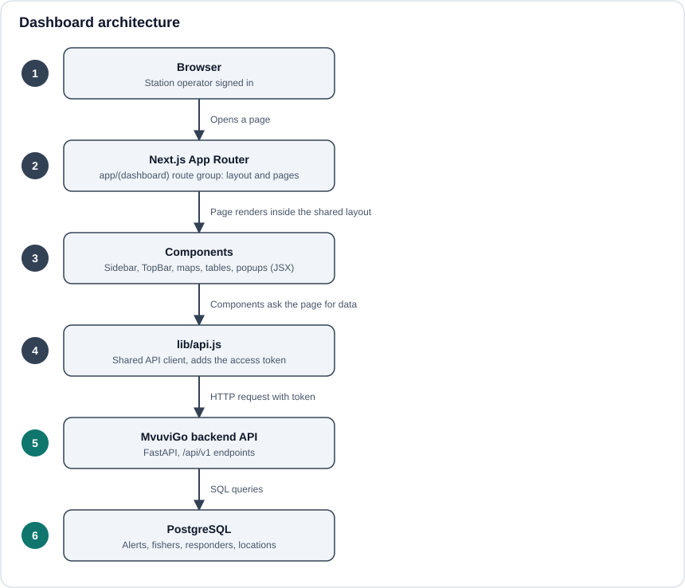

# Frontend

The MvuviGo dashboard is the screen station operators use to watch for distressed fishers and coordinate help. It lives in the `pixels-frontend` repository and is built with **Next.js** (App Router), React in **JSX**, Tailwind CSS and the Nunito font.

## What operators can do

- See fishers in distress on a live map (**Live Incidents**).
- See the nearest responders to an alert and the SMS messages sent to them (**Responders and Messages**), in either map view or list view.
- Sign in with their operator account. Everything else requires a valid session.

## In this section

- [Architecture](./architecture.md): how the app is structured and how it reaches the backend.
- [Pages and components](./pages-and-components.md): the screens and the building blocks they use.
- [State management](./state-management.md): how sign-in and data loading are handled.
- [Maps and real-time](./maps-and-real-time.md): how alerts reach the map and what happens when a pin is clicked.

