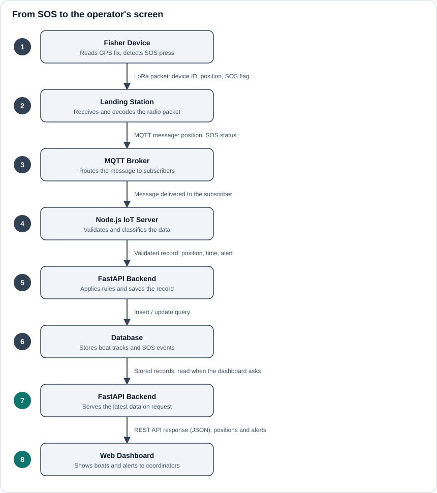

# Maps and Real-time

## From distress signal to map pin

1. A fisher in distress sends a signal from their wristband through the station device.
2. The backend creates an alert in `distressed_fisher_alerts`, linked to the fisher's latest location.
3. The dashboard loads alerts through `lib/api.js`.
4. Each open alert appears as a **red SOS pin** on the Live Incidents map.
5. The operator clicks a pin. A popup opens on that pin.
6. The operator sees the nearest responders from the `alert-responders` list and the SMS messages sent to them.

## Map behaviour

- Only **red SOS pins** open the popup, and the popup is anchored to the pin that was clicked.
- Zoom buttons sit on the map in the same place on the Dashboard, Live Incidents and Responders maps.
- The responders page offers the same map in a **Map view**, plus a **List view** of the same people.
- Pin colours: **red** for a distressed fisher, **green** for nearby fishers; amber pins also appear on the maps.

## Responders data

Each responder record carries:

| Field | Meaning |
| --- | --- |
| `distance_m` | Distance from the alert, in metres. |
| `search_radius_m` | The radius used to find responders. |
| `received_at` | When the responder was notified. |
| `arrived_at` | When the responder reached the fisher. |

Responders are ordered by distance so the nearest appear first.

## Keeping the view current

Operators need to see new alerts quickly. The page reloads alert data from the backend while it is open. When you change how often or how it refreshes, check that it does not reset the operator's zoom level or close an open popup.

| Item | Value |
| --- | --- |
| Update mechanism | Periodic reload of the alerts endpoint (polling) |
| Interval | To be confirmed |
