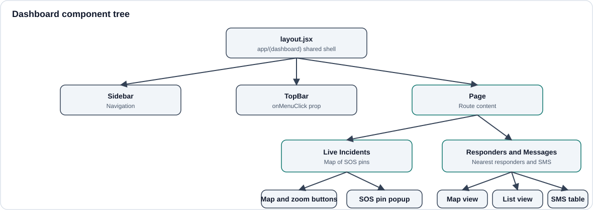
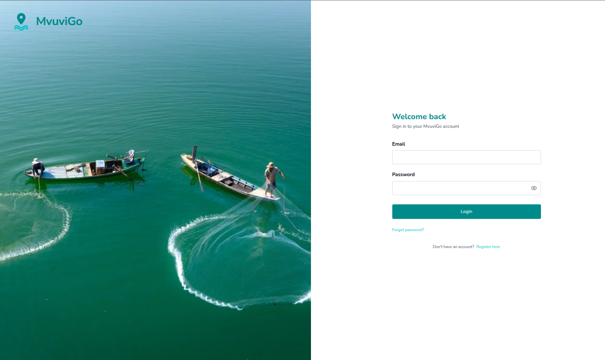
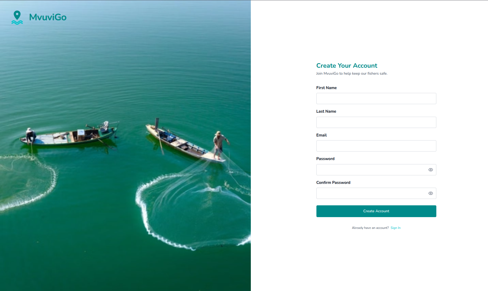
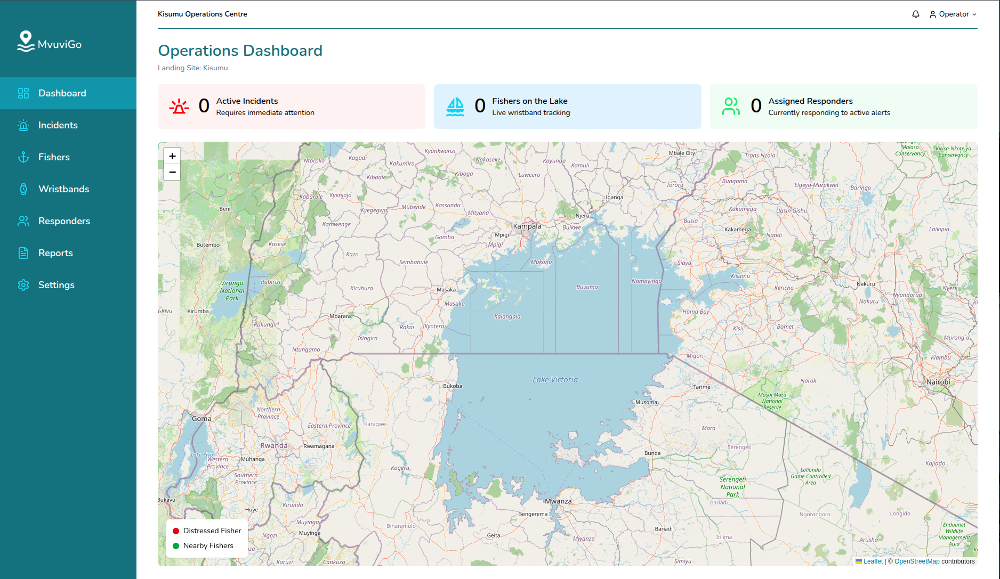
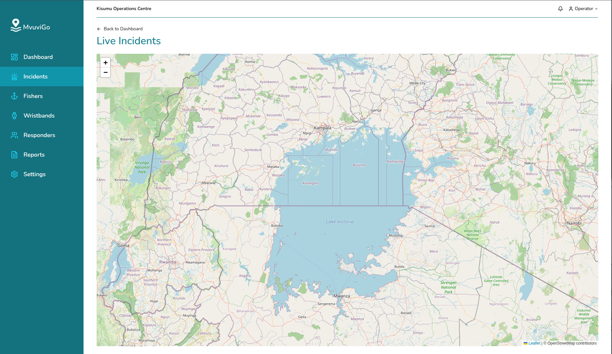
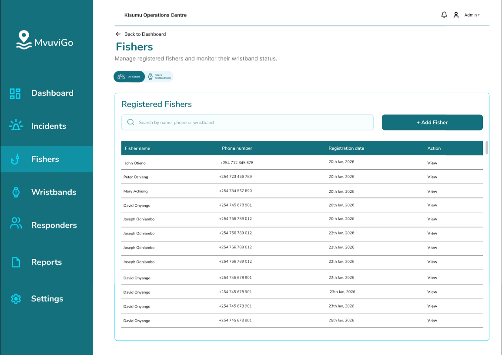
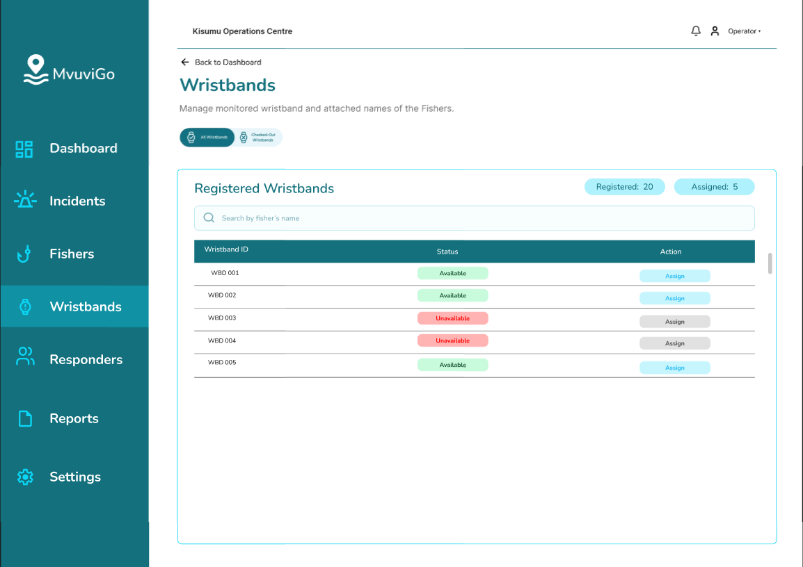
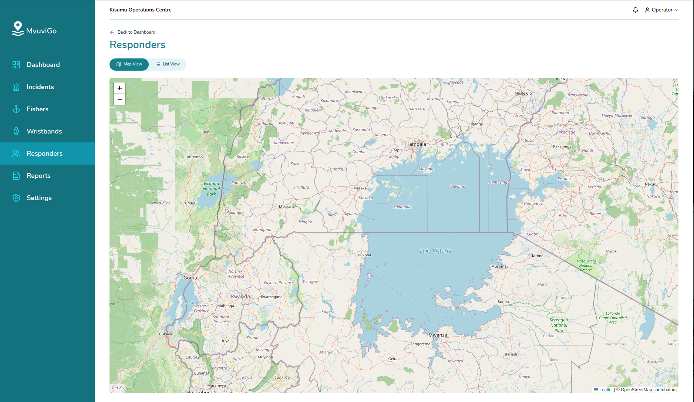
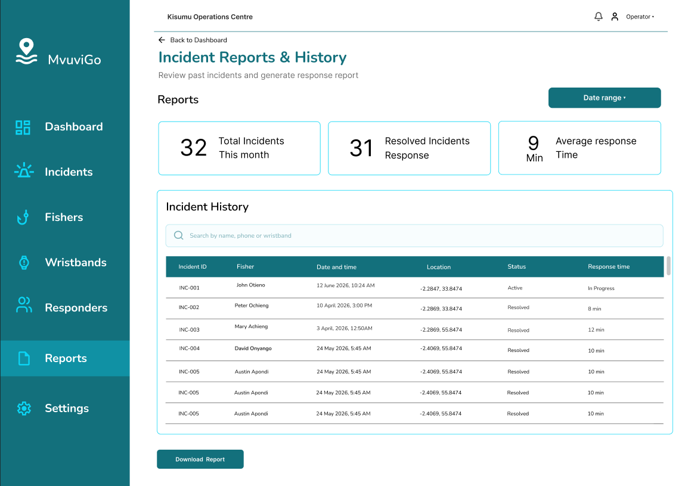
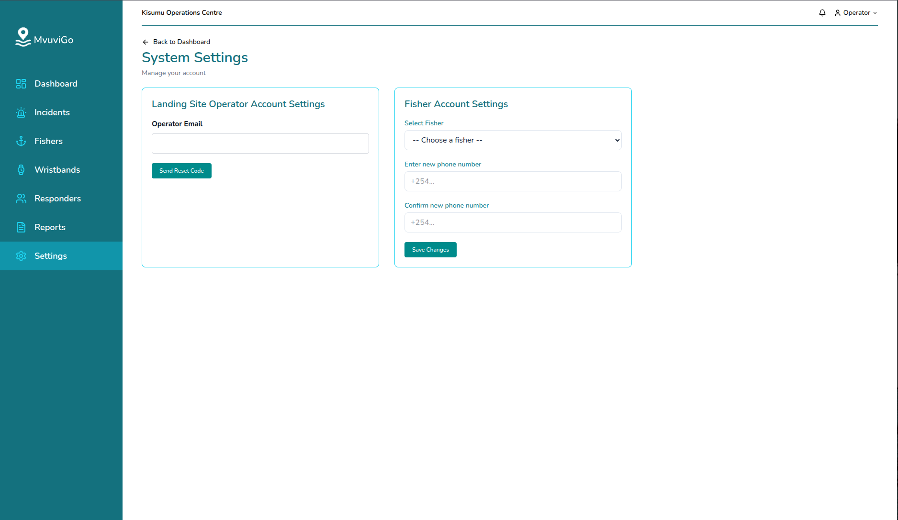

# Pages and Components

## Shared shell

Every dashboard page renders inside the `(dashboard)` layout, which provides:

- **Sidebar**: navigation between pages (Dashboard, Incidents, Fishers, Wristbands, Responders, Reports, Settings).
- **TopBar**: the header, showing the operations centre name (for example "Kisumu Operations Centre"), a notifications bell and the operator menu. It takes an `onMenuClick` prop so the sidebar can be toggled on small screens.

Pages never render their own sidebar or top bar. Doing so creates the duplicate navigation that reviewers flag.

## Public pages

### Login

The "Welcome back" page: sign in to your MvuviGo account with **Email** and **Password**, a **Login** button, a **Forgot password** link and a **Register here** link for operators without an account.

### Register

The "Create Your Account" page, with fields for **First Name**, **Last Name**, **Email**, **Password** and **Confirm Password**, a **Create Account** button and a **Sign in** link for existing operators.

## Signed-in pages

### Dashboard

The Operations Dashboard for the landing site (for example Kisumu).

- Three summary cards: **Active Incidents** (needs immediate attention), **Fishers on the Lake** (live wristband tracking) and **Responders Availability** (ready to respond).
- A lake overview map with a legend: **Distressed Fisher** (red) and **Nearby Fishers** (green).
- Popups on pins show the fisher and the case status.

### Live Incidents

A full map of active alerts.

- Fishers in distress appear as **red SOS pins**.
- Clicking a pin opens a popup that touches that pin. The popup does not open from anywhere else.
- An **Incident Details** panel shows the fisher, number of fishers, location, time and a status badge, followed by a **Response Timeline** (SOS received from a wristband, SMS sent to nearby responders, responder acknowledged, responder dispatched).
- Zoom buttons sit on the map, matching the responders map.
- The basemap uses a Stamen-style look.

### Fishers

Manage registered fishers and monitor their wristband status.

- A **Registered Fishers** table with columns Fisher name, Phone number, Registration date and Action (**View**).
- A search box (name, phone or wristband) and an **Add Fisher** button.
- A switch between the fisher list and the wristband view.

### Wristbands

Manage monitored wristbands and the names of the fishers they are attached to.

- Counters for **Registered** and **Assigned** wristbands.
- A table with Wristband ID, Status (**Available** or **Unavailable**) and Action (**Assign**).
- A search box for wristband or fisher name.

### Responders and Messages

Shows who can help and what has been sent to them.

- **Map view / List view** toggle for the nearest responders.
- A responders list that falls back to a placeholder when a responder has no name.
- An **SMS messages** table. Message data comes through the backend, which talks to the SMS provider.

### Reports

Incident Reports & History.

- Summary cards: **Total Incidents** this month, **Resolved Incidents** and **Average response time**.
- A **Date range** filter and a searchable **Incident History** table (Incident ID, Fisher, Date and time, Location, Status, Response time).
- A **Download Report** button.

### Settings

System Settings, split into two cards.

- **Landing Site Operator Account Settings**: operator email and **Send Reset Code**.
- **Fisher Account Settings**: search a fisher by name, enter and confirm a new phone number, then **Save Changes**.

## Main user workflows

| Workflow | Steps |
| --- | --- |
| Sign in | Open `/login`, enter email and password, press **Login**. On success the token is stored and the dashboard opens. |
| Register | Open `/register`, fill all five fields, press **Create Account**, then sign in. |
| Respond to an SOS | Watch the Live Incidents map, click a red pin, read Incident Details, open Responders and Messages to see the nearest responders and the SMS sent to them. |
| Register a fisher | Fishers, **Add Fisher**, fill the form, save. The new fisher appears in the table. |
| Assign a wristband | Wristbands, find an **Available** wristband, press **Assign**, choose the fisher. |
| Review history | Reports, set a **Date range**, search the history, press **Download Report**. |
| Change a fisher's phone number | Settings, search the fisher, enter the new number twice, **Save Changes**. |
| Reset operator password | Settings, check the operator email, press **Send Reset Code**. |
| Sign out | Open the operator menu in the `TopBar` and choose sign out. |

## Component guidelines

| Do | Avoid |
| --- | --- |
| One component per file | Large page files that mix data, layout and map code |
| Pass data down as props | Fetching in deeply nested presentational components |
| Reuse `Sidebar` and `TopBar` | Copying them into pages |
| Show loading, error and empty states | Rendering an empty table when a request fails |
| Reuse one generic table component for the Fishers, Wristbands and Reports tables | Writing a new table for each page |
