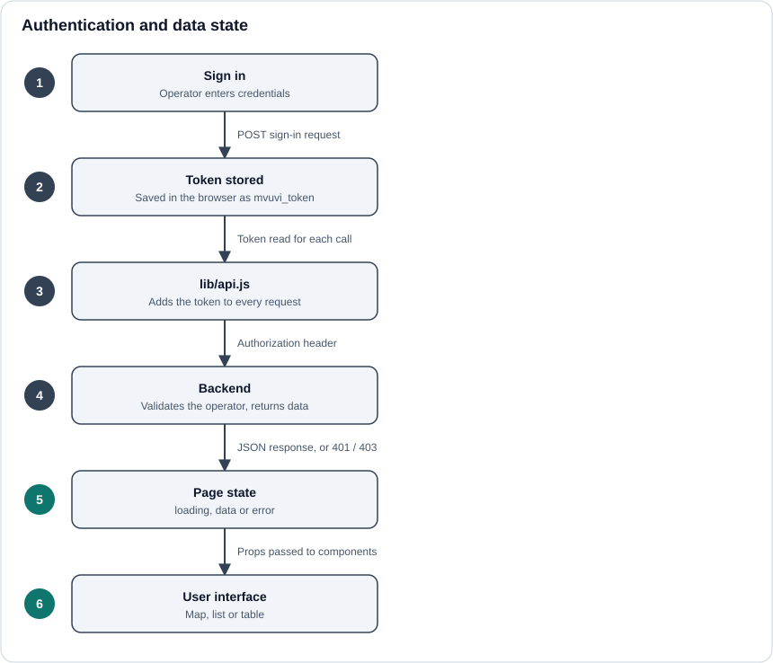

# State Management

The dashboard uses plain React state and hooks. There is no global store: each page owns the data it shows.

## Authentication

1. The operator signs in.
2. The access token is saved in the browser under the key **`mvuvi_token`**.
3. `lib/api.js` reads that key and adds the token to every request.
4. The backend checks the token and returns data for the signed-in operator.

Always use the `mvuvi_token` key and the shared client. Reading the token under a different name, or calling `fetch` directly, will make pages appear signed out.

## Page data

Each page tracks three things:

| State | Shown as |
| --- | --- |
| `loading` | A spinner or skeleton |
| `data` | The map, list or table |
| `error` | A clear message |

## Error handling

- **`401` / `403`**: show an authentication message so the operator knows to sign in again. Do not show an empty table, which looks like "no data".
- **Other errors**: show a short error message and keep the rest of the page usable.
- **Missing fields**: map API responses through a small mapper that supplies fallbacks, for example a default label when a responder has no name.

## Keeping components simple

Fetch data in the page, map it into the shape the UI needs, and pass it to child components as props. Child components stay easy to reuse and test.